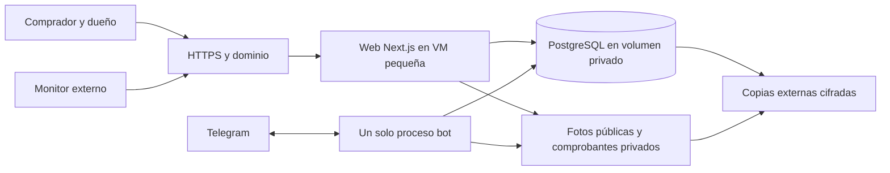

# Plan de corrección y traslado a la nube

Fecha de precios y revisión: **11 de septiembre de 2026**. Alcance: una tienda, 2–3 usuarios simultáneos y catálogo público. Presupuesto preferido confirmado: menos de US$20/mes. Tamaños actuales del escritorio inspeccionados; picos, crecimiento, retención y proveedor todavía por validar/aceptar. Las cifras siguientes son estimaciones en USD antes de impuestos, sin compromiso de contratación.

## 1. Recomendación costo/beneficio

**Con tu presupuesto de menos de US$20, recomiendo evaluar DigitalOcean: un Droplet de 2 GiB con web, bot y PostgreSQL, respaldo diario del servidor y copias de datos externas. Estimación provisional: US$16.60/mes antes de impuestos.**

Conserva Docker y permite ubicar el servicio en Estados Unidos. La base de datos será autogestionada: el ahorro exige mantenimiento, archivo continuo de WAL y pruebas de restauración. En el escritorio se observaron unos **229 MiB agregados en reposo** entre web, bot y PostgreSQL; esto no incluye una prueba de picos ni todo el gasto del sistema operativo. Los 2 GiB siguen pendientes de medir bajo carga, importación acotada y backup. El presupuesto incluye US$1 para objetos/copias bajo un escenario pequeño, ahora respaldado por tamaños reales reducidos. Antes de comprometerse a menos de US$20, hay que medir generación de WAL, compresión, operaciones de almacenamiento y retención completa, y recalcular la factura. No debemos reducir la protección de datos para cumplir artificialmente el presupuesto.

Mi candidata regional es San Francisco, sujeta a disponibilidad del plan y una prueba desde el local. No se midió latencia de ninguna nube. Hetzner en Europa es una alternativa de menor factura (unos US$9.39) si la latencia resulta aceptable, pero no asumiría que ofrece el mismo servicio regional por ese precio.

Si más adelante prefieres reducir mantenimiento de PostgreSQL, la alternativa con base administrada ronda US$31–35/mes. Queda comparada como mejora futura y no como opción principal dentro del presupuesto actual. “Base administrada” tampoco elimina el mantenimiento de la aplicación/VM.

### Comparación

Tamaño real observado: BD PostgreSQL de **9,490,915 bytes** (unos 9.1 MiB), directorio PGDATA de **65,016 KiB** y volumen uploads de **48,824 KiB**. El archivo de respaldo contiene **45 archivos / 49,891,307 bytes**, restaurados y comparados. El dump comprimido mide **69,115 bytes** y el archivo comprimido de uploads **49,828,379 bytes**, antes del envoltorio de cifrado. PGDATA incluye más que el tamaño lógico de una base; el uso del volumen tampoco es idéntico a la suma de bytes de archivos. [Inspección y restore](05-evidencia-y-limites.md).

Para comparar planes se conservan unos 10 GB provisionados donde aplica y un escenario de hasta 30 GB totales de imágenes, copias base, WAL, dumps y versiones retenidas externamente. Los datos actuales caben holgadamente, pero todavía no se comprobó el crecimiento ni la retención completa dentro de ese total. Se reserva US$1/mes para objetos/copias; no es una tarifa fija ni un límite de gasto.

| Opción | Componentes y cálculo mensual | Estimación | Ajuste al proyecto |
|---|---|---:|---|
| DigitalOcean, base administrada | VM 2 GiB US$12 + PostgreSQL 1 GiB/10 GiB base US$15.15 + backup diario VM 30% = US$3.60 + reserva objetos US$1 | **US$31.75** | Mejora futura; excede el presupuesto actual |
| **DigitalOcean, todo en VM** | VM 2 GiB US$12 + backup diario US$3.60 + objetos US$1 | **US$16.60** | Recomendada dentro del presupuesto; región americana; tú mantienes la BD |
| Hetzner CX23, Europa | VM US$6.49 + backup 20% US$1.30 + IPv4 US$0.60 + objetos US$1 | **US$9.39** | Muy económico; región y disponibilidad requieren prueba; BD propia |
| Hetzner CPX21, EE. UU. | VM US$37.49 + backup 20% US$7.50 + IPv4 US$0.60 + objetos US$1 | **US$46.59** | A precios actuales pierde ventaja frente a DO para esta opción |
| Railway Pro, por consumo | Ejemplo: RAM agregada media 2 GB = US$20; CPU media 0.1 = US$2; volumen 10 GB = US$1.50; salida 10 GB = US$0.50; mínimo Pro US$20 incluido, no sumado; objetos US$1 | **US$25 ejemplo; prever US$20–35** | Despliegue cómodo, factura variable y adaptación de archivos compartidos |
| Render, mínimo pagado | Web 512 MB US$7 + worker 512 MB US$7 + PostgreSQL 256 MB US$6; almacenamiento, objetos y excedentes aparte | **US$20 base; reservar US$25–30** | Menos mantenimiento de SO; probar memoria/BD y mover archivos a objetos |
| AWS Lightsail, VM 4 GB | Instancia con IPv4 US$24 + snapshots/backup independiente y objetos adicionales | **US$24 base; reservar US$28–35** | Válida; BD autogestionada, más configuración que valor adicional aquí |

**Fuentes del cálculo:** [Droplets y backups](https://www.digitalocean.com/pricing/droplets), [PostgreSQL administrado](https://www.digitalocean.com/pricing/managed-databases), [Hetzner: tarifas por región vigentes tras junio](https://docs.hetzner.com/general/infrastructure-and-availability/price-adjustment/), [backups Hetzner](https://docs.hetzner.com/cloud/billing/faq/), [IPv4 Hetzner](https://docs.hetzner.com/general/infrastructure-and-availability/ipv4-pricing/), [Railway](https://railway.com/pricing), [unidades de consumo Railway](https://docs.railway.com/pricing/plans), [Render](https://render.com/pricing), [Lightsail](https://aws.amazon.com/lightsail/pricing/).

Precios de Hetzner en esa fuente excluyen IPv4 e impuestos; por eso ambos se separan. No usar precios antiguos de US$4–7 para servidores estadounidenses. La disponibilidad del CX23 no se confirmó en una cuenta.

La documentación general de PostgreSQL de DigitalOcean todavía dice “desde US$15”; para el cálculo usé la tabla de precios específica actual, que muestra **US$15.15**. Confirmar región y disco seleccionados en la cotización antes del pago.

**No incluidos:** impuestos, variación cambiaria, dominio si se necesita uno nuevo, comisiones de cobro, correo transaccional, soporte de desarrollo, exceso de datos/tráfico, registro privado de imágenes si exige plan pagado y un staging permanente. El dominio existente podría reutilizarse después de verificar quién lo administra. Un staging temporal se cobra por su tiempo de uso.

### Qué cambia entre estas opciones

- **VPS:** permite mantener app y bot con un volumen compartido al inicio. Eso simplifica migración, pero los comprobantes deben salir de public y tener lectura privada.
- **Railway:** su plantilla PostgreSQL es explícitamente no administrada en términos de configuración/mantenimiento; no equipararla a un servicio de BD plenamente gestionado. No asumir que un volumen se comparte entre web y bot. Sus volúmenes limitan réplicas y producen un breve corte en redespliegues. [PostgreSQL](https://docs.railway.com/databases/postgresql), [volúmenes](https://docs.railway.com/volumes/reference).
- **Render:** un disco persistente sólo es accesible por una instancia de servicio; web y bot necesitan almacenamiento de objetos común. El plan mínimo tiene poca memoria: un importador Excel sin límites puede agotarlo. Los servicios con disco también tienen restricciones de despliegue/escalado. [Discos](https://render.com/docs/disks), [planes de cómputo](https://render.com/docs/compute-plans).
- **Planes gratuitos:** no los usaría para la base de esta tienda. Por ejemplo, PostgreSQL gratuito de Render expira a los 30 días. [Restricciones oficiales](https://render.com/docs/free).
- **Vercel/serverless o web estática:** no son un traslado directo de este stack con bot continuo, cron, SSE y archivos en disco. No compensa dividirlo más sólo para perseguir un precio inicial bajo.

No hace falta un balanceador, varias réplicas, Kubernetes ni otra base de caché para 2–3 usuarios. Si alguna vez se escala, antes habrá que sustituir los Maps locales de sesiones/notificaciones y controlar trabajos duplicados.

### Almacenamiento de archivos y copias

Separar tres destinos: fotos públicas de producto, comprobantes privados y copias de recuperación privadas. Una misma cuenta de objetos puede contener buckets con credenciales distintas. La credencial de la aplicación no debe poder eliminar las copias.

Cloudflare R2 Standard publica US$0.015/GB-mes, 10 GB-mes gratuitos, cuotas gratuitas de operaciones y salida sin cargo. Por ejemplo, 30 GB-mes totales equivalen a unos US$0.30 de almacenamiento por encima de la cuota, antes del redondeo y operaciones; presupuestar US$1 deja margen para el escenario pequeño, no garantiza un costo máximo. [Tarifas R2](https://developers.cloudflare.com/r2/pricing/).

No asumir que el almacenamiento de objetos por sí solo es respaldo: una aplicación con permiso de borrar todos los objetos puede borrar también sus datos. Hace falta copia separada, retención y comprobación. No sobrescribir comprobantes ni fotografías versionadas; mantener metadatos y referencias.

## 2. Arquitectura propuesta

- Mantener monolito modular: servicios compartidos de inventario, pedido, pago y reserva; API web/bot invocan las mismas reglas.
- Web, bot y PostgreSQL comparten la VM pero usan procesos/volúmenes separados. Validar los 2 GiB midiendo el pico conjunto durante operaciones, importación acotada y backup; vigilar memoria disponible, disco y crecimiento de WAL. Si no hay margen, redimensionar y volver a aceptar el costo antes del corte. La base sólo está en la red interna de Docker, sin publicar 5432.
- App y bot con roles de BD de privilegio mínimo; conexión privada/TLS según proveedor, validación de certificado, sin desactivar TLS para “hacerlo funcionar”.
- Exponer sólo HTTPS al público. Administración por SSH con llave y Tailscale o red restringida.
- App no ejecuta migraciones al arrancar. Un job de despliegue hace la migración, verifica resultado y sólo entonces promueve la imagen.
- Una instancia de bot con long polling. Un único responsable de expiración con exclusión por fila y reintentos idempotentes.
- Para notificaciones, una tabla/outbox en PostgreSQL basta inicialmente. Publicar después del commit y reintentar sin duplicados.
- Compilar imágenes en entorno de construcción y llevar artefactos a la VM; evitar consumir toda su memoria construyendo mientras atiende ventas.
- Fijar una versión Node LTS soportada y digests de imagen. Node 20 del Dockerfile actual figura EOL; Node 22/24 figuran LTS en la fuente consultada. [Ciclo oficial de Node.js](https://nodejs.org/en/about/previous-releases).

## 3. Protección de datos y objetivos verificables

Tu prioridad de no perder datos exige protegerse también de errores del programa y borrados, no sólo de apagones. Un backup diario puede perder todas las operaciones desde la última copia; sincronizar carpetas tampoco evita propagar un borrado.

**Ya realizado:** copia cifrada AES-256-GCM fuera de Syncthing, con clave separada, y restauración aislada de los datos reales sin red y con almacenamiento temporal en memoria. Coinciden conteos y SHA-256 de las 16 tablas y de los 45 archivos. Se retiró el contenedor de restore; permanecen el respaldo cifrado, recuperador e instrucciones fuera de la carpeta sincronizada. Es una prueba puntual de recuperación de BD/archivos; el origen permaneció activo y las dos capturas no son una instantánea conjunta atómica. No se respaldaron/restauraron roles productivos ni configuración secreta, no se levantaron app/bot restaurados ni se ensayaron PITR/WAL, RPO o RTO. Copia y clave están en la misma Mac, por lo que todavía no cubren pérdida de ese equipo. No se verificó un respaldo externo automático preexistente. [Evidencias del restore real](05-evidencia-y-limites.md).

**Propuesta inicial, a aceptar con el dueño:**

| Situación | Protección | Objetivo y límite |
|---|---|---|
| Se apaga el escritorio | Servicio y datos en nube | El sitio continúa; el local necesita internet/energía o un teléfono |
| Falla la VM o su disco | Backup base + archivo de WAL fuera de la VM + imágenes versionadas | Objetivo RTO ≤4 h, con expectativa inicial de 2–4 h que debe medirse en ensayo |
| Error/borrado en BD | Copia base diaria + WAL continuo; restaurar aislado y conciliar operaciones válidas | Objetivo RPO ≤5 min con cadena WAL completa; recuperar el dato sin descartar ventas posteriores al error |
| Pérdida de cuenta/proveedor o borrado completo | Backups base y WAL cifrados en proveedor distinto + dump de respaldo horario + archivos | RPO objetivo ≤5 min si la cadena WAL está completa; hasta 1 h si sólo sobrevive el dump horario |
| Archivo borrado o reemplazado | Objetos con identificadores inmutables y copia separada | Recuperar versión referenciada; medir lag de copia y alertar |
| Cobro confirmado pero respuesta al cliente se pierde | Idempotencia + documento persistido | Consultar el mismo folio; no cobrar ni descontar de nuevo |

Estos son **objetivos de diseño, no garantías comprobadas**. Una arquitectura económica con copias asíncronas no permite prometer pérdida cero ante cualquier desastre. Si se exige cero transacciones confirmadas perdidas incluso al desaparecer una región/proveedor, se necesita una arquitectura y presupuesto distintos. Alta disponibilidad y copia de seguridad solucionan problemas diferentes.

En la alternativa administrada fuera del presupuesto, DigitalOcean documenta copias de PostgreSQL diarias retenidas siete días y restauración; comprobar en el ensayo la ventana exacta disponible del plan elegido. Las copias del proveedor no sustituyen un respaldo independiente que sobreviva a un problema de cuenta. [Restauración PostgreSQL](https://docs.digitalocean.com/products/databases/postgresql/how-to/restore-from-backups/). El nodo único administrado no es un clúster de alta disponibilidad. La VM económica tampoco es alta disponibilidad; esto es coherente con tu tolerancia a interrupciones. [Tipos de clúster](https://docs.digitalocean.com/products/databases/postgresql/details/pricing/).

**Implementación concreta de respaldo para la VM recomendada:** usar una herramienta compatible con PostgreSQL 16 y almacenamiento S3 para copias base y archivo continuo de WAL; fijar versiones y ensayar recuperación a un instante (PITR). Evaluar `archive_timeout=60s` para rotar segmentos con poca actividad y alertar antes de cinco minutos de atraso. Ese ajuste puede aumentar el volumen archivado: medirlo comprimido. Conservar sin huecos los WAL y archivos de historial necesarios desde el inicio del backup base más antiguo de la ventana PITR retenida hasta el punto recuperable; un WAL reciente no prueba continuidad. Coordinar la limpieza de WAL con la retención de bases. [Archivado continuo y PITR de PostgreSQL 16](https://www.postgresql.org/docs/16/continuous-archiving.html).

Mantener dump lógico horario como segunda vía de recuperación. Ni copiar PGDATA con Syncthing ni el snapshot diario del VPS son sustitutos. Las claves de recuperación deben sobrevivir a la pérdida de la VM. Ante corrupción lógica, restaurar primero en entorno aislado, identificar los datos correctos y conciliar ventas/pagos válidos posteriores al incidente antes de reponer producción. Volver toda la base a un instante anterior sin conciliación también puede perder operaciones legítimas.

**Política inicial de retención, pendiente de dimensionar:** 48 copias horarias, 30 diarias y 12 mensuales, cifradas antes de transferir y con credenciales separadas. Definir qué copias son dumps independientes y cuáles son bases físicas; la ventana PITR requiere además su cadena WAL completa. No se asume PITR de doce meses por conservar doce dumps mensuales. Calcular el almacenamiento comprimido de todas las copias, WAL y archivos antes de aprobar el margen de US$1 o prometer mantenerse por debajo de US$20. Para comprobantes y datos personales acordar retención específica con el negocio. Alerta de backup vencido, validación automática de archivo legible y restauración mensual a un entorno vacío. Registrar fecha, resultado, conteos, saldos y duración. El backup que sólo “se subió correctamente” no demuestra recuperabilidad.

**Syncthing:** usarlo para archivos de trabajo si se desea, nunca como réplica en vivo del directorio de datos PostgreSQL. Sincronizar código no actualiza una imagen Docker ya construida. Para BD: dump consistente o respaldo nativo con WAL. Para imágenes: copiar el volumen realmente montado. Evitar guardar secretos y dumps sin cifrar dentro de carpetas sincronizadas.

## 4. Plan detallado por entregas

Estimaciones orientativas para una persona desarrollando y validando con el dueño; la instancia real ya está accesible e inspeccionada. No son plazo comprometido ni deben sumarse a los calendarios de los anexos. Varias tareas de preparación pueden hacerse en paralelo; las escrituras y el corte requieren renovar y verificar el respaldo apropiado para esa intervención.

### Entrega A — Origen y recuperación · inspección y restore puntual realizados

1. **Realizado:** autenticación SSH mediante `galindoasc-desktop`, hostname GALINDOASC, e inspección de los contenedores ProSolutions sin modificar datos comerciales.
2. **Realizado:** identificación de app/bot activos, PostgreSQL 16.11, montajes, puertos y tamaños. El par activo de volúmenes es `prosolutions_postgres_data` / `prosolutions_uploads`; de los volúmenes heredados sólo se comprobó presencia, no se deben confundir con el origen activo.
3. **Realizado con límite:** 167 archivos idénticos entre Mac, fuente sincronizada de Windows y fuente de imagen del bot; el archivo fuente de uploads sólo está en Mac, pero se comprobó que su artefacto compilado existe en la app productiva. package.json/schema.prisma coinciden; runtime real Next 16.1.6 y Node 20.20.2. Sigue sin atribuirse toda la imagen web a un commit; el árbol Git del escritorio tiene cambios locales.
4. **Realizado:** conteos/agregados de datos reales, sin publicar registros personales: 98 productos, 5 usuarios, 3 reservas, 153 movimientos de inventario, 9 de crédito, 5 de caja y 1 caja. Cero productos con stock negativo en esa consulta; esto no invalida el defecto concurrente reproducido en fixture.
5. **Realizado:** copia cifrada fuera de Syncthing y restore aislado de BD/uploads; coincidencia completa de conteos y hashes de 16 tablas y 45 archivos. El dump de BD es consistente; la captura de archivos se tomó aparte con el origen activo.
6. **Pendiente:** conciliar saldos y compromisos con el dueño, completar inventario de configuración necesaria y ensayar captura coordinada para el corte. Mantener todos los datos como reales; no etiquetarlos como pruebas por su importe.
7. **Pendiente:** implantar/verificar respaldo externo automático, ventana y continuidad WAL, retenciones, alertas y ensayo completo de aplicación. La revisión limitada no verificó backups externos automáticos anteriores.

**Salida ya obtenida:** instancia activa identificada y copia puntual de BD/archivos recuperada con tamaños conocidos. **Para cerrar recuperación operativa:** automatización y ensayo completo medidos, además de conciliación con el dueño. No ejecutar seed, db push, reset, clean ni down -v sobre producción.

### Entrega B — Contención y acceso seguro · 2–4 días

1. Retirar fix-catalog público y revisar todo endpoint de mantenimiento.
2. Validar callback de login y añadir prueba de marcador inocuo.
3. Publicar sólo campos permitidos de catálogo, detalle y búsqueda; confirmar política de mayoreo/stock.
4. Revalidar rol/estado actual, revocar sesiones y evitar borrar último administrador.
5. Unificar registro Telegram y rate limit, con normalización y límites de cuenta/IP.
6. Separar comprobantes privados de fotos; migrar archivos existentes y revisar enlaces/caches.
7. Rotar la contraseña de PostgreSQL, que **sí coincide con el default Compose en la instancia real**, coordinando la credencial nueva en app y bot y verificando reconexión. Cerrar/restringir 5432; está publicado en interfaces del host, sin prueba de acceso desde Internet. Quitar defaults, endurecer bootstrap y contexto Docker. Estas modificaciones aún no se hicieron. Los secretos de sesión reales son iguales entre sí, tienen al menos 32 caracteres y no coinciden con el fallback; no confundir esa comprobación con la contraseña DB.
8. Actualizar dependencias con revisión; no aplicar audit fix --force ni downgrades automáticos.

**Salida:** matrices de autorización pasan con HTTP real; XSS bloqueado, pagos privados, baja de usuario efectiva y ninguna mutación administrativa anónima. Login y registro públicos conservan únicamente las operaciones previstas y sus límites. Corregir avisos aplicables o documentar excepción concreta con fecha y mitigación.

### Entrega C — Inventario y pedidos confiables · 5–8 días

1. Funciones de dominio compartidas para cotizar, reservar, vender, entregar, cancelar y devolver.
2. Contratos de entrada únicos; cantidad >0, precio autorizado por servidor, moneda y centavos/Decimal.
3. Pedido/venta con folio y líneas; transacción que incluya disponibilidad, reserva/salida y registros financieros.
4. Actualización condicional de stock y bloqueo de saldo de cliente cuando aplique; reintentos de conflicto controlados.
5. Idempotencia de petición y unicidad de asientos; recuperar resultado después de un timeout.
6. Matriz de estados exhaustiva, eliminación de PAID/SHIPPED no modelados y cancelación del propietario.
7. Reversión exacta del crédito/anticipo y separación de efectivo/tarjeta/transferencia.
8. Contramovimientos en anulaciones/devoluciones; archivo lógico de productos/clientes; preservar caja cerrada.
9. Un único proceso de expiración transaccional y persistencia de aviso.
10. Conciliar históricamente stock/saldos con el dueño; los movimientos actuales no son un ledger completo, no reconstruir a ciegas.

**Salida:** una pieza acepta una sola reserva concurrente; reintentos no duplican; fallo de una línea revierte el pedido; cancelación libera una vez; caja contiene sólo efectivo real; crédito cuadra con asientos.

Crédito, metas mensuales y administración extensa por bot son módulos opcionales: pueden deshabilitarse por configuración y corregirse después. La desactivación debe bloquear nuevas operaciones en APIs/comandos, además de ocultar menús; conservar historia y acceso autorizado para conciliar registros existentes. No autoriza borrar deudas ni ignorar compromisos pendientes.

**Condición para avanzar al corte:** acceso, catálogo, stock, pedidos/ventas, medios de pago usados y recuperación del núcleo habilitado deben pasar sus pruebas. Un módulo opcional no bloquea el corte sólo si está efectivamente deshabilitado, se ha probado que no acepta operaciones y sus registros pendientes están identificados y conciliados con el dueño. Las reservas y avisos de cliente por bot, si se mantienen, forman parte de ese núcleo.

### Entrega D — Calidad de operación diaria · 3–5 días, parcialmente paralela

1. Catálogo y reservas con paginación real, búsqueda estable y filtros en URL.
2. Comprobante cliente funcional con control de propiedad, mensajes de carga/error y validación de archivo.
3. Escaneo exacto y cámara cerrada correctamente.
4. Ticket multiartículo y reimpresión con datos históricos; selección de etiquetas completa.
5. Una navegación administrativa compacta; controles por rol; esconder módulos no utilizados.
6. Diferenciar error de servidor de lista vacía; conservar borrador y mostrar “sin confirmar” ante desconexión.
7. Normalizar texto y accesibilidad teclado/VoiceOver; probar 390/768/820/1024 px.
8. Corregir lint y añadir CI que impida promover errores.
9. PWA: sustituir/integrar mecanismo compatible con el build; caché sólo de recursos públicos, sin auth/pagos/admin. No activar los defaults inseguros al reparar el worker.
10. Elegir Telegram o completar push con permisos y pruebas en dispositivo; retirar del producto promesas sin implementar.

**Salida:** el dueño puede completar las operaciones frecuentes sin rutas repetidas, información ausente ni acciones tapadas.

### Entrega E — Ensayo y corte a nube · 2–3 días después de los controles B/C del núcleo habilitado

1. Medir picos conjuntos de memoria/disco y tamaño comprimido de datos, WAL y retenciones; elegir proveedor/plan y fijar presupuesto aceptado. Contratar sólo tras esa decisión.
2. Crear entorno privado, secretos distintos y red cerrada; imágenes por digest.
3. Preparar baseline real y migraciones; quitar db push del arranque y health que sólo hace SELECT 1.
4. Restaurar la copia y archivos; verificar compatibilidades, fotos, saldos, permisos y tamaño.
5. Ensayar copia final, duración, restauración, configuración de URL/auth y único bot.
6. Probar interrupción/reinicio controlados, rollback y alertas sin ventas/cobros reales.
7. Ejecutar ventana de corte descrita abajo.
8. Observar 24–48 h de operación y realizar primera restauración del backup nuevo.

**Salida:** dominio sirve nube, escritura confirmada funciona, sólo hay un origen activo, backups/alertas operan y el dueño acepta el recorrido.

### Entrega F — Mejoras por retorno · módulos pequeños posteriores

Garantías/devoluciones → ubicaciones/conteos → variantes/compatibilidad → recepción/proveedores → reposición. Pasarela automática sólo si el dueño la necesita. Cada módulo se entrega con un recorrido de aceptación; no desarrollar una suite completa sin uso confirmado.

## 5. Ventana de migración sin dividir los datos

**Antes:** reducir TTL si se usa DNS, verificar acceso a dominio/certificado, construir imágenes antes de detener origen y probar destino con host temporal. Preparar página de mantenimiento y responsables. Enmascarar o deshabilitar notificaciones externas en staging; nunca arrancar dos bots con el mismo token.

**Durante el corte:**

1. Anunciar mantenimiento y cerrar nuevas escrituras web/POS del origen.
2. Detener únicamente bot/cron ProSolutions del escritorio para que no acepte pedidos ni venza reservas.
3. Tomar backup final consistente y copiar el delta de uploads; registrar hora exacta, esquema y conteos.
4. Restaurar al destino, aplicar migraciones aprobadas y comparar invariantes.
5. Validar en privado: login, catálogo, acceso a archivos privados, pedido sintético, cancelación, ticket y saldo.
6. Cambiar DNS/túnel al destino y arrancar el único bot/worker de producción.
7. Hacer smoke del dominio público desde otra red y un recorrido acordado con el dueño.
8. Mantener origen detenido para escritura y conservar copia congelada para recuperación.

La ventana debe medirse en ensayo; no prometer cinco minutos sin conocer tamaño de BD/archivos y velocidad del escritorio.

**Si hay que volver:**

- **Antes de aceptar escrituras nuevas en nube:** volver al origen congelado, URL anterior y un único bot.
- **Después de aceptar escrituras en nube:** bloquear escrituras nuevas, respaldar destino y migrar/reconciliar esas operaciones al origen antes de abrirlo. Cambiar DNS solamente perdería las operaciones nuevas.
- No borrar volúmenes del escritorio ni retirar su copia final hasta completar aceptación y período de retención acordado.

## 6. Criterios de aceptación que deben quedar automatizados

| Prueba | Resultado exigido |
|---|---|
| Anónimo escribe catálogo o lee costos/comprobantes | 401/403 o sólo DTO público permitido; cero mutaciones |
| Admin revocado con cookie anterior | Acceso rechazado inmediatamente |
| Callback de login con esquema externo/JavaScript | Destino rechazado, no ejecución |
| Dos canales compiten por última unidad | Exactamente un éxito y stock ≥0 |
| Misma venta enviada dos veces | Mismo folio y un solo cobro/salida |
| Falla deliberada en línea dos | No queda una venta parcial |
| Cliente cancela propia reserva válida | Éxito y una sola liberación de stock/compromiso |
| Rechazar/cancelar/entregar dos veces | Segunda petición no genera movimientos nuevos |
| Crédito cancelado o devuelto | Saldo/compromiso corregido; ninguna salida ficticia de efectivo |
| Cierre de caja y venta simultáneos | Una asignación coherente a turno; sin asientos posteriores ocultos |
| Devolución parcial repetida | Acumulado ≤ vendido y reembolso ≤ cobrado |
| Productos >20 y etiquetas multipágina | Todos navegables y etiquetas completas |
| Archivo inválido/importación con fila errónea | Error controlado, sin cambios parciales silenciosos |
| Migración en vacío y copia existente | Esquema esperado; fallo detiene promoción |
| Restore nuevo de BD+archivos | Conteos, saldos y hashes coinciden con snapshot |
| Caída/reinicio de bot/worker | Reanuda, no duplica, alerta si deja de trabajar |
| Usuario A sale y entra B | B no recibe caché, carrito ni notificaciones privadas de A |
| iPhone físico: cámara y PWA | Permiso/control adecuados; cámara se apaga; offline no confirma ventas |

## 7. Operación después del traslado

- Diario automático: disponibilidad HTTP y consulta de esquema, última ejecución del worker, cola pendiente, backups, espacio y errores.
- Alertas con acción concreta: backup más viejo de lo acordado, worker atrasado, DB sin conexión, espacio >80%, errores de checkout o conciliación.
- Semanal: revisar actualizaciones/avisos aplicables y cambios en costos; deploy con smoke y posibilidad de retorno.
- Mensual: restauración completa en entorno aislado, prueba de permisos y revisión con dueño de funciones realmente usadas.
- Dueño conserva acceso a proveedor, dominio y mecanismos de recuperación; desarrollador usa cuenta individual de soporte. Guardar secretos en gestor, no en informes ni capturas.
- Registro de cada release: versión/hash, migraciones aplicadas, quién desplegó y resultado de validación.

Este plan prepara una migración revisable; no representa una autorización para gastar ni un despliegue ya efectuado.
